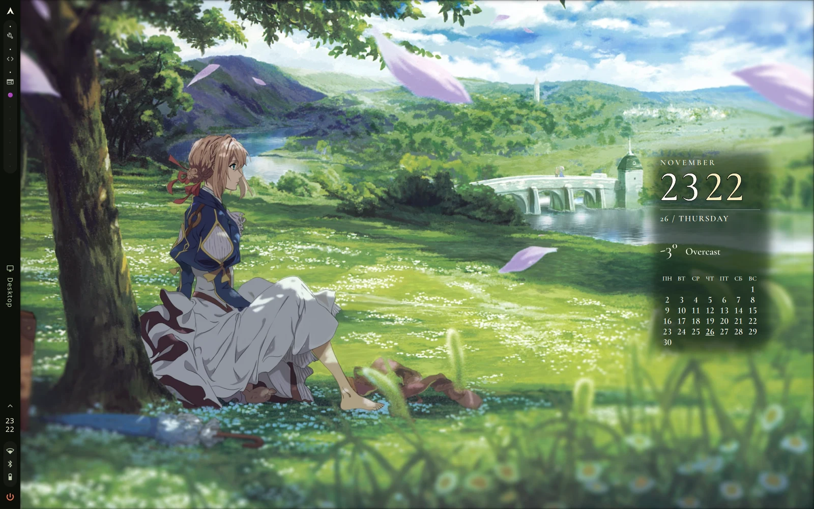
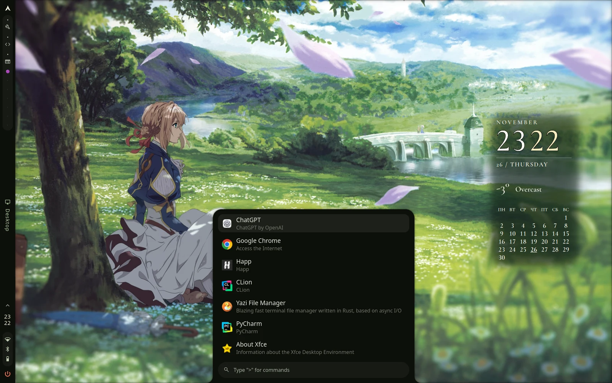
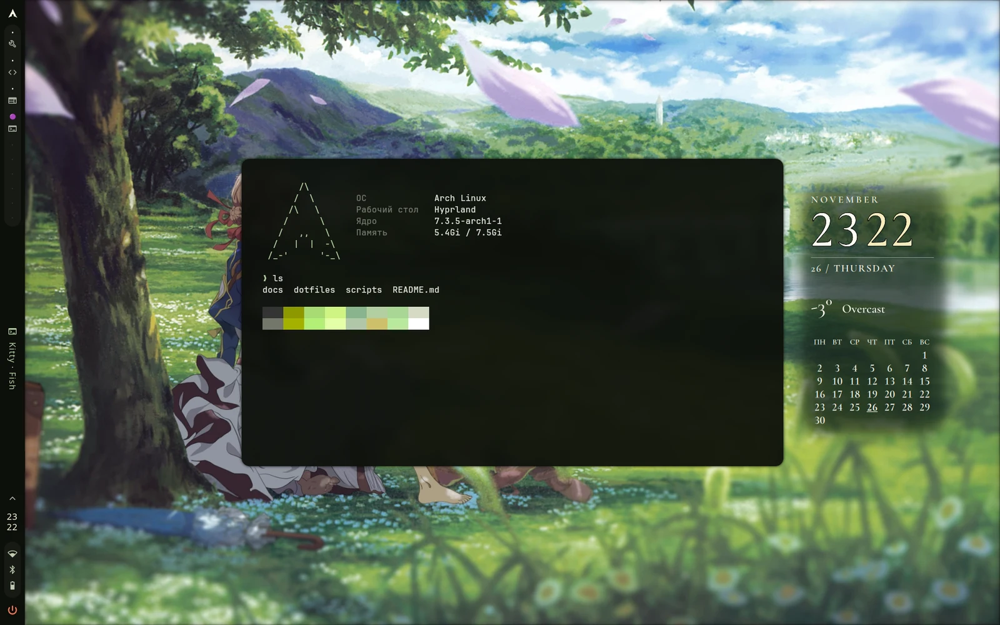
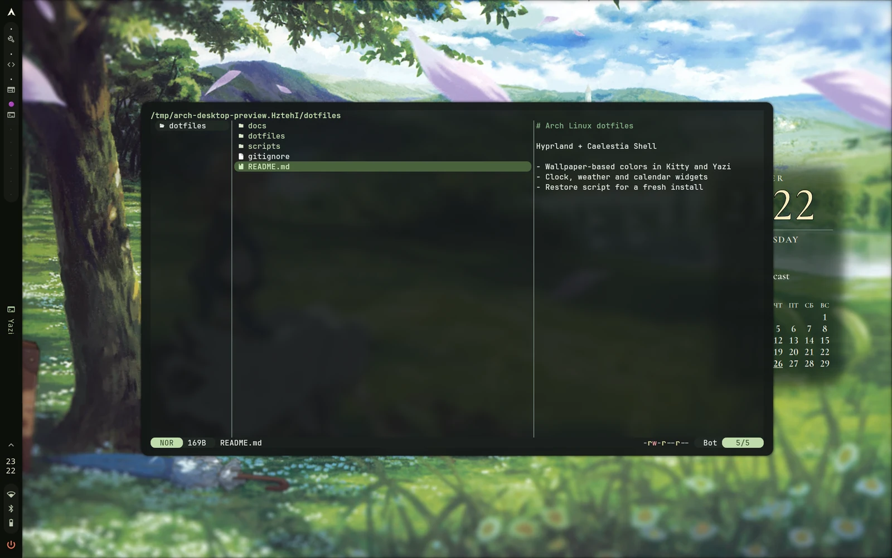

# Hyprland, Caelestia и Violet

Конфигурация рабочего стола для Arch Linux с Hyprland и Caelestia Shell. Можно взять отдельные настройки или развернуть всё окружение по инструкции ниже.

- **Hyprland** — Lua-конфиг с горячими клавишами, правилами окон, анимациями и автозапуском.
- **Caelestia и Quickshell** — настройки оболочки, часы, календарь, погода и управление музыкой на рабочем столе.
- **Violet** — тема экрана входа SDDM и переход к рабочему столу.
- **Fish, Kitty и Yazi** — палитра терминала и акценты файлового менеджера меняются вместе с темой Caelestia.

## Скриншоты



<details>
<summary>Лаунчер приложений Caelestia</summary>



</details>

### Kitty

Терминал с Fish и палитрой, подобранной по обоям.



### Yazi

Тёмный полупрозрачный фон и акценты текущей темы. Отдельное окно открывается по **Super+Y**.



[Все восемь обоев в оригинальном размере](dotfiles/Pictures/Wallpapers)

## Восстановление после переустановки

1. Установите пакеты из официальных репозиториев Arch.

   ```bash
   sudo pacman -S --needed git python hyprland xdg-desktop-portal-hyprland \
     xdg-desktop-portal-gtk pipewire wireplumber fish kitty yazi thunar fuzzel \
     wl-clipboard cliphist brightnessctl playerctl libnotify grim slurp \
     gpu-screen-recorder ttf-jetbrains-mono-nerd ttf-material-symbols-variable ttf-cormorant
   ```

2. Установите пакеты Caelestia из AUR привычным способом. Окружение проверялось с Hyprland 0.57.2, Caelestia Shell 2.5.0, Caelestia CLI 1.1.3 и `quickshell-git` 0.3.2.r11. Виджеты используют файлы из `/etc/xdg/quickshell/caelestia`, которые ставит пакет `caelestia-shell`.

   ```bash
   yay -S --needed caelestia-shell caelestia-cli quickshell-git \
     redhat-fonts ttf-phosphor-icons ttf-rubik-vf
   ```

3. Клонируйте этот репозиторий по HTTPS. Из каталога с README запустите восстановление обычным пользователем.

   ```bash
   git clone https://github.com/Mouse-ai/arch-hyprland-dotfiles.git
   cd arch-hyprland-dotfiles
   python3 restore.py --dry-run
   python3 restore.py
   ```

   Скрипт сохраняет заменяемые файлы в `~/hyprland-before-restore-…` и подставляет путь к каталогу обоев текущего пользователя в настройки Caelestia. Заново войдите в Hyprland. Чтобы вернуть последние выбранные обои, выполните в графической сессии:

   ```bash
   caelestia shell wallpaper set "$HOME/Pictures/Wallpapers/evergarden-serenity.webp"
   ```

   При смене обоев Caelestia обновляет цвета Kitty и Yazi. Шаблоны лежат в каталоге `~/.config/caelestia/templates/`.

## Экран входа Violet

Violet использует [SilentSDDM](https://github.com/uiriansan/SilentSDDM) версии 1.5.x (пакет `sddm-silent-theme` версии 1.5.1-1 на исходной машине). Изменённые файлы темы сохраняют лицензию GPL-3.0-or-later. После установки `sddm` и `sddm-silent-theme` выполните из корня репозитория:

```bash
(
  set -eu
  base=/usr/share/sddm/themes/silent
  theme=/usr/share/sddm/themes/violet
  test -f "$base/Main.qml"
  if ! sudo test -d "$theme"; then
    sudo cp -a "$base" "$theme"
  fi
  sudo cp -a sddm/violet/. "$theme/"
  sudo install -m 0644 dotfiles/Pictures/Wallpapers/violet-login.webp \
    "$theme/backgrounds/violet-login.webp"
  sudo install -m 0644 dotfiles/Pictures/Wallpapers/violet-desktop.png \
    "$theme/backgrounds/violet-transition.png"
  sudo install -Dm 0644 sddm/99-violet.conf /etc/sddm.conf.d/99-violet.conf
)
```

Если SDDM ещё не включён и выбран менеджером входа, включите его командой `sudo systemctl enable sddm.service`. Тема загрузится при следующем запуске SDDM. В копию входят файлы рабочего стола. Системный загрузчик, настройки других приложений и личные данные восстанавливаются отдельно.
